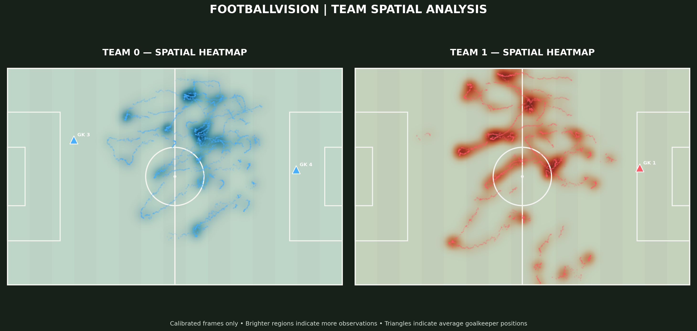
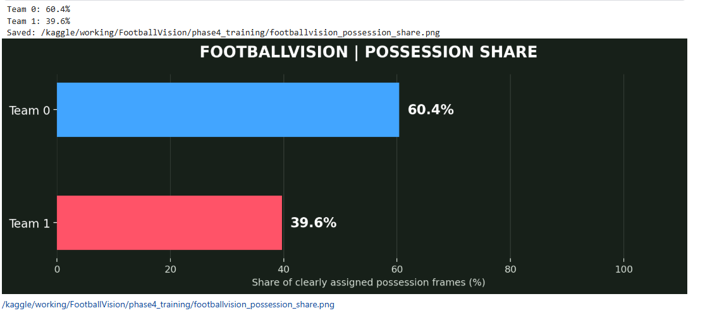
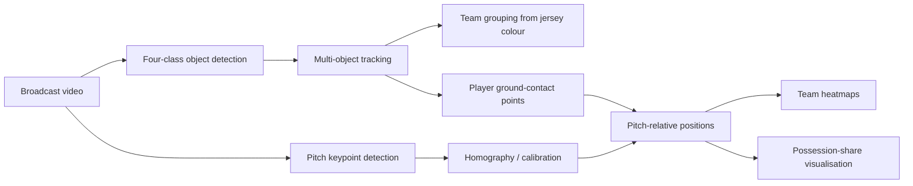

# FootballVision

FootballVision is a computer-vision workflow for analysing a broadcast football clip. It combines a four-class object detector, multi-object tracking, unsupervised team grouping, pitch-landmark detection, homography-based pitch projection, and small spatial analytics visualisations.

The work is organised as exploratory, reproducible notebooks rather than a one-command application. Detection, tracking, calibration, and analytics are distinct stages with their own assumptions and failure modes.

## Project highlights

- Fine-tunes a YOLO26 Small detector for **ball**, **goalkeeper**, **player**, and **referee** classes.
- Tests ByteTrack and OC-SORT for persistent object identities across a match clip.
- Groups outfield-player tracks into two teams from jersey-colour features using K-Means.
- Uses a separate YOLOv8x-Pose pitch-keypoint model to estimate a per-frame image-to-pitch homography.
- Projects bottom-centre player locations onto a 105 m × 68 m reference pitch for spatial heatmaps and a possession-share estimate.

## Visual demo

The final demonstration combines detection, tracking, and homography-based pitch mapping:

[▶ Watch the final FootballVision demo in the browser](https://anishh3.github.io/footballvision/)

[Download the final FootballVision demo video (MP4)](https://raw.githubusercontent.com/anishh3/footballvision/main/outputs/Video%20Project%202%20%282%29.mp4)

[Browse the repository copy](outputs/Video%20Project%202%20%282%29.mp4)

GitHub does not render MP4 files inline in every README view; download or open the link above to play it.

## Results and visualisations

### Qualitative detector predictions

Validation-batch prediction images produced by the main detector-training notebook.

| Validation batch 0 | Validation batch 1 | Validation batch 2 |
| --- | --- | --- |
|  |  |  |

### Team spatial heatmaps



The heatmaps aggregate projected, confidence-filtered player observations from frames with accepted calibration. The notebook retained 547 of 750 frames for this analysis and treats goalkeeper locations separately.

### Possession-share estimate



This is an estimate from the project's implemented tracking and possession logic, calculated over clearly assigned frames. It is not independently verified ground-truth possession.

## Pipeline architecture



The object detector/tracker and the pitch-keypoint model are trained and run separately; the workflow does not train these stages jointly. Calibration is applied only where a trustworthy homography is available.

## Notebook guide

| Notebook | Purpose |
| --- | --- |
| [01-main-model-training.ipynb](notebooks/01-main-model-training.ipynb) | Downloads the Roboflow Football Detection v11 dataset, validates its YOLO splits, and fine-tunes YOLO26 Small for ball, goalkeeper, player, and referee detection. The three validation images above are qualitative predictions from this work. |
| [02-detection-tracking-experiments.ipynb](notebooks/02-detection-tracking-experiments.ipynb) | Runs detection and tracking experiments on a 750-frame broadcast clip. It evaluates ByteTrack and OC-SORT configurations, including separate lower ball thresholds, then builds track-level team assignments from jersey-colour features and K-Means. |
| [03-pitch-calibration-homography.ipynb](notebooks/03-pitch-calibration-homography.ipynb) | Trains/uses a separate pitch keypoint model, maps predicted pitch landmarks to a 105 m × 68 m reference layout with RANSAC homography estimation, and applies the calibration to tracked player ground-contact points. |
| [04-football-analytics.ipynb](notebooks/04-football-analytics.ipynb) | Filters tracking/calibration data to valid frames, creates team spatial heatmaps, and renders the possession-share chart. |

## Datasets and attribution

| Dataset | Role in FootballVision |
| --- | --- |
| [Roboflow Football Detection — Version 11](https://universe.roboflow.com/amsroboflow/football_detection-ybjkh/dataset/11) | Four-class object-detection dataset used for the main detector: ball, goalkeeper, player, and referee. |
| [Roboflow Football Field Detection — Version 18](https://universe.roboflow.com/roboflow-jvuqo/football-field-detection-f07vi/dataset/18) | Pitch landmark/keypoint dataset used by the separate calibration model. |

Please follow the source datasets' licences and Roboflow terms when downloading or redistributing data.

## Models and methodology

**Object detection.** The main notebook fine-tunes YOLO26 Small at 960 px. The detection notebook uses the resulting checkpoint with class-specific inference/display thresholds; ball detection is treated more permissively because the ball is small.

**Tracking and team labels.** ByteTrack and OC-SORT are the implemented tracker experiments. Player identities can change after occlusion, missed detections, or re-entry, so a track ID is not a guaranteed player identity. The team step derives HSV colour features from player crops and clusters them into two groups; goalkeeper and referee labels are not used as team evidence in the same way.

**Pitch calibration.** A YOLOv8x-Pose model predicts 32 pitch keypoints. The calibration notebook rescales keypoints from square inference back to the video frame, uses selected landmarks and `cv2.findHomography(..., RANSAC, ...)`, and maps player bounding-box bottom centres to reference-pitch coordinates. Its saved run accepted 547/750 frames; rejected frames are deliberately omitted from pitch-relative analytics.

## Setup and installation

Python 3.10+ and a CUDA-capable GPU are recommended for training and practical video inference. The notebooks were authored for Kaggle paths, so update dataset, checkpoint, output, and video paths for your environment.

```bash
git clone https://github.com/anishh3/footballvision.git
cd footballvision
python -m venv .venv
```

Activate the environment:

```bash
# Windows PowerShell
.venv\Scripts\Activate.ps1

# macOS / Linux
source .venv/bin/activate
```

```bash
python -m pip install --upgrade pip
pip install -r requirements.txt
```

Install a PyTorch build appropriate for your CUDA platform if the default `torch` package is not suitable; see the [official PyTorch selector](https://pytorch.org/get-started/locally/).

## How to run the notebooks

1. Download the two datasets from the linked Roboflow pages and provide credentials through a secret manager or environment variable—never commit an API key. The placeholder `"your-api-key"` cells are intentionally non-functional.
2. Set the dataset, model-weight, and video paths at the top of each notebook. The original runs use Kaggle locations under `/kaggle/input` and `/kaggle/working`.
3. Run notebook 01 to train/evaluate the object detector, then notebook 02 to produce tracking data and team labels.
4. Run notebook 03 to train/use the pitch-keypoint model and generate aligned homographies.
5. Run notebook 04 after the tracking and calibration artifacts exist to generate heatmaps and the possession chart.

Model checkpoints, calibration arrays, tracking pickles, raw video, and datasets are intentionally ignored by Git. See [weights/README.md](weights/README.md) for the expected artifacts and regeneration path.

## Repository structure

```text
.
├── notebooks/                 # Training, tracking, calibration, and analytics notebooks
├── outputs/                   # Public qualitative images and final demo video
├── weights/                   # Local-only artifacts; documentation is tracked
├── notes/                     # Project planning notes
├── README.md
├── requirements.txt
└── .gitignore
```

## Limitations and future improvements

- Small, motion-blurred, or occluded balls can be missed; lower detection thresholds can also introduce false positives.
- Tracker IDs may switch or fragment during occlusions and crowded play, which propagates into team and possession estimates.
- Jersey-colour clustering can be confused by lighting, shadows, goalkeeper kits, and pitch/background pixels.
- A homography is only an approximation of broadcast-camera geometry. Pitch keypoint failures and partial views cause rejected or inaccurate calibration; ground-contact points are inferred from bounding boxes.
- The possession chart is a heuristic estimate, not event-annotated ground truth.

Potential next steps include temporal smoothing of calibration, tracker re-identification evaluation, ball-trajectory filtering, event detection, quantitative evaluation on labelled matches, and a packaged inference application.

## Acknowledgements

Built with [Ultralytics](https://www.ultralytics.com/), [Roboflow](https://roboflow.com/), OpenCV, and the open-source Python scientific-computing ecosystem. Thanks to the creators of the Football Detection and Football Field Detection datasets linked above.
